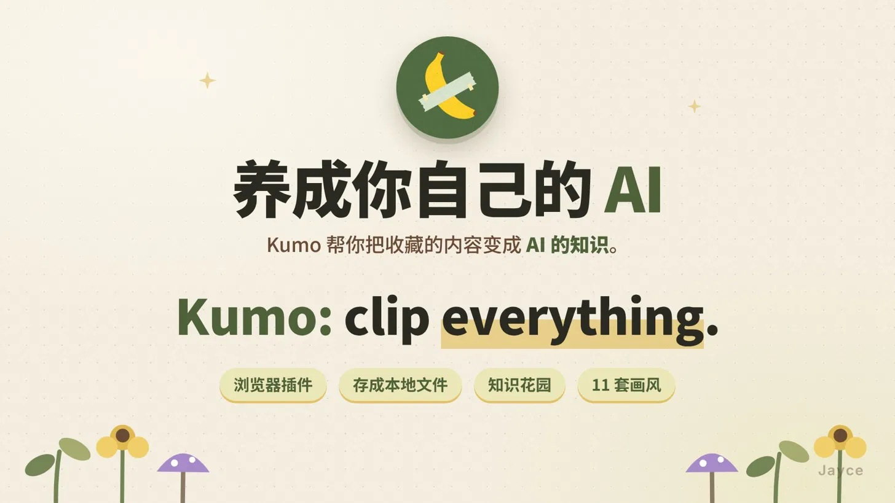
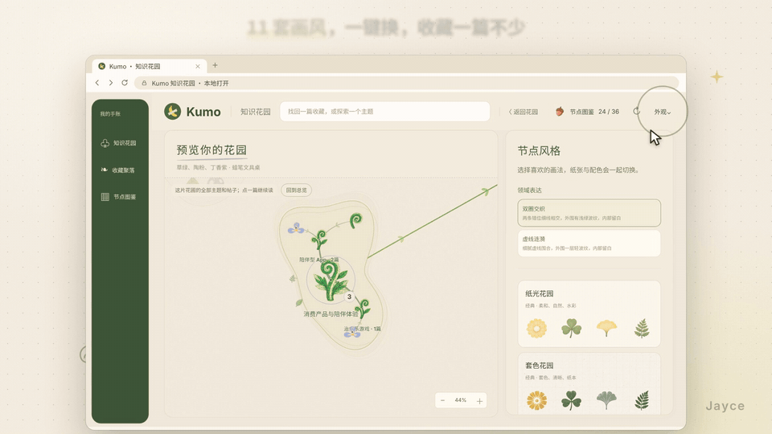
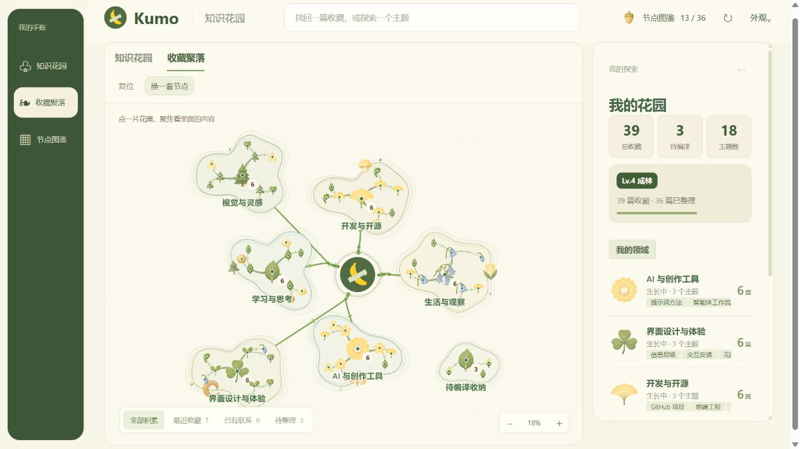
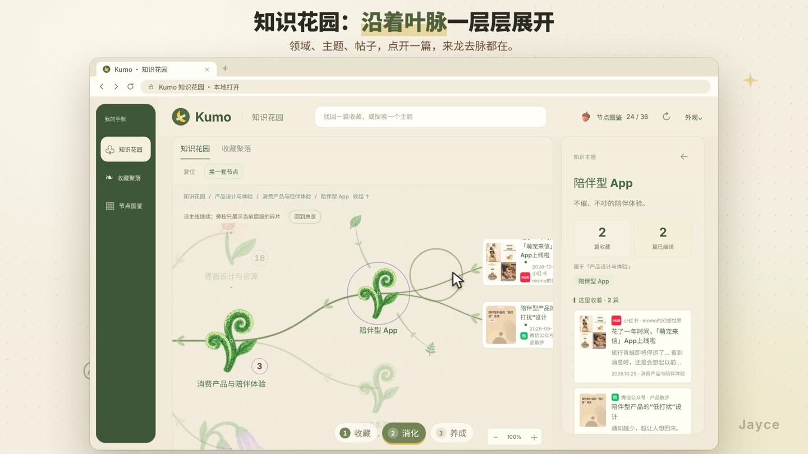
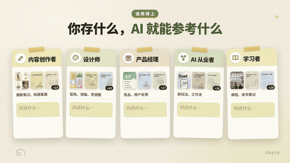

<h1 align="center">Kumo · Clip Everything</h1>

<strong>让收藏，长成自己的知识花园。</strong> 留下网页与想法，在下一次需要时，找回、理解，再用上。

<a href="https://megumin61.github.io/Kumo/">产品官网</a> · <a href="https://www.xiaohongshu.com/user/profile/5f92e666000000000100aca2">小红书</a> · <a href="https://github.com/Megumin61/Kumo/releases">下载</a> · <a href="docs/INSTALL.md">安装指南</a>

Kumo 是一款以本地文件夹为资料库的网页剪藏工具。浏览器扩展保存来源和笔记；收藏聚落与知识花园帮助探索内容；单独连接的 AI 插件负责检索、精读和经授权的整理。

## 看看它如何生长

[在线体验双视图花园](https://megumin61.github.io/Kumo/#playground) · [切换全部 11 套真实画风](https://megumin61.github.io/Kumo/#styles) · [浏览器 / AI 插件安装指南](https://megumin61.github.io/Kumo/#start)

官网提供明确标注的虚构示例，可展开领域、主题和帖子，种下模拟收藏、缩放与重置。演示只在当前页面内生效，不连接或写入个人资料库。

[播放 60 秒新版演示](docs/media/kumo-product-demo.mp4) · [在线演示与功能介绍](https://megumin61.github.io/Kumo/#demo) · [下载仓库后离线播放](docs/media/index.html)

视频与画风动图由 Jayce 提供，官网与仓库使用同一套素材。视频介绍产品流程；AI 界面的演示不代表仅安装浏览器扩展即可自动连接所有 AI 工具。

## 为什么做 Kumo

很多好内容停在了「我好像存过」。一条链接容易找不回来，一张截图也不一定留下上下文。Kumo 希望先保留可读取的内容、来源和自己的想法，再让相关材料长出主题与领域，成为之后做设计、学习和项目时能用上的参考。

花园是一种浏览和组织知识的表达。这里的“养成 AI”指积累可供 AI 参考的资料，**不是训练模型**。

## 核心功能

| 部分 | 能做什么 | 使用条件 |
| --- | --- | --- |
| 浏览器剪藏 | 保存标题、作者、来源、可读取正文、主要图片和笔记；Windows 默认 Ctrl+Q | 安装浏览器扩展，选择保存位置；实际键位可在保存设置中调整 |
| 收藏列表与合集 | 查找收藏、查看原文和媒体、管理标签与笔记 | 本地助手连接同一资料库 |
| 收藏聚落 | 从领域圈层看主题与收藏分布，待编译材料独立收纳 | 本地助手；主题知识需要 AI 整理 |
| 知识花园 | 领域 → 主题 → 帖子逐层探索，回到原始材料 | 本地助手与资料库中的编译内容 |
| 节点图鉴与外观 | 植物节点、双款标识、11 套画风切换 | 知识视图中的「外观」与图鉴 |
| AI 检索与整理 | 按任务查找、读取原文、说明依据；预览并经授权保存派生知识 | 兼容本地插件的桌面客户端，单独安装、连接与授权 |

### 同一片花园，不同的样子

纸光、套色、彩铅、蜡笔、印章等共 11 套画风。动图展示部分切换效果，全部样式在产品「外观」中选择。

### 把收藏重新连回内容

界面图用于功能说明，节点数量与内容随资料库变化。收藏保存成功，不等于已经被 AI 编译。

### 日常操作的小片段

官网以静音视频循环播放四段模块切片，并提供对应 GIF；可随时暂停动效。

## 从哪里开始

1. **先保存。** [下载浏览器包](https://github.com/Megumin61/Kumo/releases)，解压后在 Edge / Chrome 的扩展管理页加载含 `manifest.json` 的文件夹。打开网页，选择资料目录并保存。
2. **再查看花园。** 安装本地助手，连接同一个资料目录。需要 Node.js 22+；源码安装先运行 `npm run setup`，再运行 `npm run helper -- --library "资料文件夹完整路径"`。
3. **需要 AI 时再连接。** 在兼容本地插件的 ChatGPT Work / Codex 桌面客户端安装 Kumo，先说“检查 Kumo 连接”，确认目录与权限，再开始检索或整理。

完整步骤：[安装指南](docs/INSTALL.md)。网页端 ChatGPT 或其他 AI 软件不会仅因装了浏览器扩展就自动读取本地文件。

## 可以这样使用

- “找出我收藏里关于信息层级的三篇参考，读原文，说明各自适合什么场景。”
- “对比我保存的两个 GitHub 项目，列出实现条件和还需要核实的地方。”
- “整理新收藏，保留我的标签和原件，先给我看分类与主题计划。”

更多例子与边界见 [功能介绍](docs/FEATURES.md)。任务相关时，宿主 AI 可以决定检索收藏；Kumo 不保证每次提问都自动召回，也不在没有任务时自行发送通知。

## 采集与资料处理

可保存网页的可读取内容，以及 GitHub 可访问的项目说明、B 站标题／作者／封面／简介与链接。结果受网站结构、登录状态、权限和媒体可用性影响，不宣称覆盖所有平台的完整内容或任意收藏夹批量导出；视频链接不等于已理解整段视频。

收藏以本地文件保存。AI 实际读取并返回的资料会进入当前宿主上下文，遵循其数据政策；本地保存不等于离线推理。默认只读，整理和派生写入需授权；原件与人工标签保留。

## 发布状态 · 2026-10-26

- 浏览器本地版：**0.18.1**；本地助手：**0.17.1**；AI 本地插件包：**0.13.4**（核心 **0.13.3**）。
- Edge：最近一次成功核验为 0.18.0 **In review**。0.18.1 更新上传遇到网络错误，最终提交尚未确认；没有正式商店安装链接。
- AI 插件：提供本地安装；尚未在 OpenAI 公共目录上架，不将源码或本地包称为市场认证。

[发布状态](docs/PUBLISHING.md) · [更新记录](CHANGELOG.md) · [源码结构与开发](docs/DEVELOPMENT.md)

## 许可与联系

保留 [PolyForm Noncommercial 1.0.0 许可](LICENSE) 与依赖的第三方许可。源码可见不等于可以不受限制地商用；品牌图也不代表已完成商标或版权清权。

[GitHub Issues](https://github.com/Megumin61/Kumo/issues) · [小红书主页](https://www.xiaohongshu.com/user/profile/5f92e666000000000100aca2) · [隐私政策](https://kumo-clip-jayce.ximisapa.chatgpt.site/privacy) · 支持邮箱：ximisapa61@gmail.com。
